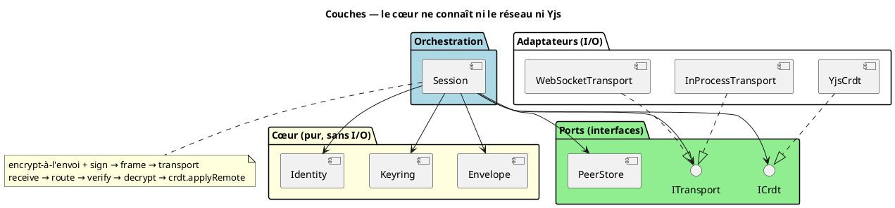
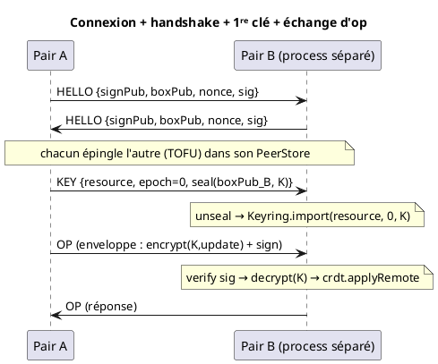
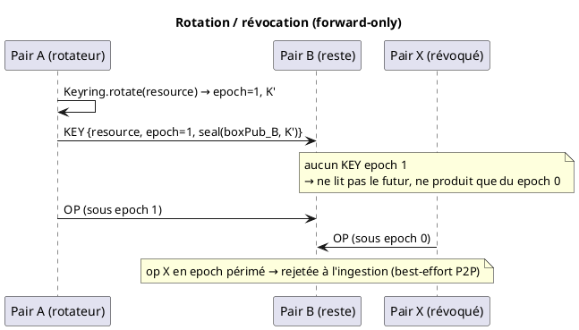
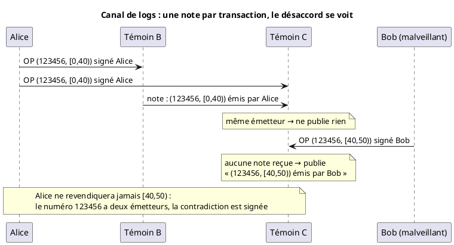

<!-- SPDX-License-Identifier: AGPL-3.0-or-later -->
<!-- SPDX-FileCopyrightText: 2026 Jean Leloup -->

# EdgeSync — protocole de collaboration P2P (design)

Lib réutilisable, **agnostique au transport et au CRDT**, pour de l'édition
collaborative **chiffrée de bout en bout et signée**, strictement **pair-à-pair**.
Chaque participant est un `Peer` qui tourne *cette même lib*. Le modèle de confiance
et de clés vit dans [security-channel-model.md](security-channel-model.md) ; ce
document décrit l'**architecture logicielle** et le **protocole de fil**.

## A. Périmètre

**Dans le protocole (v0)** : identité (2 paires de clés), CRDT chiffré, enveloppe
signée, époques + rotation, handshake entre pairs, livraison de clé wrappée.

**Hors protocole — explicitement** :
- **Le serveur.** Il n'est *jamais* une brique du protocole. S'il existe, c'est un
  **assistant externe** : soit un *peer headless always-on* (il tourne la même lib,
  sans privilège), soit un *provider de clés/identité*. Aucun code de ce protocole ne
  suppose sa présence.
- ACL op-log (capacités seules en v0), partage par lien, OPRF, persistance des clés
  au repos (éphémères en mémoire pour le POC), découverte / NAT traversal.

> Conséquence d'architecture : **aucune dépendance, aucun `if (server)`** dans le
> cœur. Le serveur n'est qu'un `Peer` ou un `KeyProvider` injecté de l'extérieur,
> plus tard.

## B. Architecture (hexagonale, dépendances vers le centre)



- **Identity** *(pur)* — les 2 paires d'un pair (Ed25519 signe, X25519 wrap) +
  l'identité publique des pairs.
- **Envelope** *(pur)* — sérialise/parse l'enveloppe de fil ; `encrypt`/`decrypt`
  (XChaCha20-Poly1305) ; `sign`/`verify` (Ed25519) ; `seal`/`unseal` (hybride
  X25519). Fonctions pures sur des octets.
- **Keyring** *(pur)* — clés de contenu par ressource : époques, historique
  `{époque → clé}`, époque courante ; `rotate`, `import` (depuis un wrap reçu).
- **ICrdt** *(port)* — le protocole ne connaît pas Yjs ; il parle à une interface.
- **ITransport** *(port)* — le protocole ne connaît pas le réseau ; deux adaptateurs
  (in-process pour les tests, WebSocket pour deux process séparés).
- **PeerStore** *(magasin §1.5.1)* — clés publiques connues, épinglées en TOFU au
  handshake.
- **IStorage** *(port)* — persistance (identité, keyring, peerstore, contenu en
  ciphertext). Le protocole ne gère pas le chiffrement au repos : c'est l'app
  ([ADR-0011](adr/0011-persistance-port-istorage.md)). Adaptateurs : in-memory,
  filesystem.
- **Session** — l'unique orchestrateur. Câble tout, applique encrypt-à-l'envoi,
  route les messages entrants, gère rotation/grant, et `persist()` via `IStorage`.

## C. Interfaces (contrats)

```ts
// ---- Cœur : pur, aucune I/O ----
interface PeerIdentity { signPub: Uint8Array; boxPub: Uint8Array }   // public
interface OwnIdentity extends PeerIdentity {
  sign(msg: Uint8Array): Uint8Array
  unseal(sealed: Uint8Array): Uint8Array          // X25519 → moi
}

// Envelope (fonctions pures)
type Envelope = { epoch: number; nonce: Uint8Array; ciphertext: Uint8Array;
                  sig: Uint8Array; signerPub: Uint8Array }
encodeEnvelope(e: Envelope): Uint8Array
decodeEnvelope(b: Uint8Array): Envelope
encrypt(key: Uint8Array, plaintext: Uint8Array): { nonce; ciphertext }   // XChaCha
decrypt(key: Uint8Array, nonce: Uint8Array, ciphertext: Uint8Array): Uint8Array
seal(recipientBoxPub: Uint8Array, plaintext: Uint8Array): Uint8Array      // hybride
unseal(boxPriv: Uint8Array, sealed: Uint8Array): Uint8Array

interface Keyring {
  currentEpoch(resource: string): number
  key(resource: string, epoch: number): Uint8Array | undefined  // historique
  rotate(resource: string): { epoch: number; key: Uint8Array }  // nouvelle époque
  import(resource: string, epoch: number, key: Uint8Array): void // depuis un KEY reçu
}

// ---- Ports ----
interface ICrdt {
  onLocalUpdate(cb: (update: Uint8Array) => void): () => void
  applyRemote(update: Uint8Array): void
  snapshot(): Uint8Array
  stateVector(): Uint8Array                       // pour le catch-up
  diffSince(sv: Uint8Array): Uint8Array
}
interface ITransport {
  onMessage(cb: (from: string, bytes: Uint8Array) => void): () => void
  onPeerUp(cb: (from: string) => void): () => void
  send(to: string, bytes: Uint8Array): void
}

// ---- Orchestrateur ----
class Session {
  constructor(id: OwnIdentity, crdt: ICrdt, keyring: Keyring,
              transport: ITransport, peers: PeerStore, resource: string)
  rotate(): void          // nouvelle époque + seal aux pairs connus + envoi KEY
  grant(peer: PeerIdentity): void   // seal la clé courante à un nouveau pair
}
```

## D. Modèle crypto (rappel + 1 décision)

- Chaque op : **chiffrée** (XChaCha20-Poly1305, époque courante) **+ signée**
  (Ed25519). Enveloppe `[epoch:4][nonce:24][ciphertext][sig:64][signerPub:32]`, la
  signature couvre `epoch‖nonce‖ciphertext`.
- **Chiffrement ⊥ signature** : l'AEAD authentifie le groupe, la signature
  l'individu (§1.1).
- **Époques** : tag en clair, auto-validé par l'AEAD. **Encrypt-à-l'envoi** :
  l'historique de clés sert à *lire* le passé, la frontière de poussée est toujours
  sous l'époque courante.
- **Révocation forward-only** : rotation = révoque la lecture ; détenir la clé
  courante = droit d'écrire (write-revocation, best-effort en P2P).

> **DÉCISION OUVERTE — Q1, modèle de clés.**
> *Proposé* : enveloppe `K_vault → K_doc` par ressource dès v0 (passe-partout +
> partage fin). *Alternative* : une clé de contenu unique epoch'd (plus simple,
> reporte la hiérarchie). → à trancher avec toi.

## E. Protocole de fil (messages)

> Référence détaillée champ par champ (déclencheurs, validation, séquences) :
> [edgesync-wire-protocol.md](edgesync-wire-protocol.md). Vue d'ensemble ci-dessous.

Message encadré = `[type:1][payload]`.

| Type | Payload | Rôle |
|---|---|---|
| `HELLO` | `{ signPub, boxPub, nonce, sig(nonce) }` | handshake : prouve l'identité, épingle en TOFU (PeerStore) |
| `OP` | une **enveloppe** (cf. §D) | une transaction **en direct** : ce que le signataire vient d'écrire, rien de relayé |
| `KEY` | `{ resource, epoch, sealed }` | livraison de clé wrappée (grant + rotation) |
| `SYNC_REQ` | `{ stateVector }` | *(si Q4 = complet)* demande de catch-up |
| `SYNC_RESP` | `{ ops[] \| snapshot }` | *(si Q4 = complet)* réponse de catch-up |
| `STATE_PUSH` | une **enveloppe** | état complet re-poussé après réception d'une clé (rattrapage) |

> `OP` d'un côté, `SYNC_RESP` et `STATE_PUSH` de l'autre : la réception est la
> même, mais seul `OP` dit « le signataire a écrit ceci ». Le rattrapage porte les
> écritures de tous sous la signature de celui qui répond. Le canal de logs (§K)
> repose sur cette distinction.

**Gossip** ([ADR-0018](adr/0018-gossip-strategie-injectable.md)). `OP`,
`ACL_REQUEST` et `EPOCH_PUSH` sont relayés au-delà des voisins, **à l'identique**,
une seule fois par pair, et seulement après vérification (signature et droit de
l'auteur ; pour une époque, après adoption). Un `OP` relayé reste donc signé par
son auteur. La stratégie est un port injectable (`IBroadcast`) ; l'adaptateur par
défaut, `FloodBroadcast`, envoie à tous les voisins sauf l'expéditeur. Le reste
(`KEY`, `HELLO`, rattrapage) reste point à point.

> **DÉCISION OUVERTE — Q4, périmètre des messages.**
> *Proposé* : commencer **minimal** (`HELLO` + `OP` + `KEY`). *Alternative* :
> inclure `SYNC_*` dès v0 — en P2P pur, la reconnexion d'un pair en retard est
> fréquente, donc le catch-up a plus de valeur ici qu'en mode serveur. → à trancher.

## F. Modèle de connexion P2P (POC)

Pur P2P, **sans signaling** : un `Peer` peut à la fois **écouter** et **composer**.
Le test lance le pair B dans un **process séparé** qui écoute ; le pair A compose
vers B. Les deux tournent un code identique ; « écouter » n'est qu'un rôle, pas un
serveur. En production, on remplace l'adaptateur `ITransport` (WebRTC / libp2p /
réseau local) — *le protocole ne change pas*.

## G. Séquences





## H. Plan de test (headless, vitest, pur P2P)

| # | Assertion | Transport |
|---|---|---|
| a | les octets sur le transport sont du **chiffré** (aucune fuite du clair) | in-process |
| b | deux pairs **convergent** sur le message | in-process |
| c | **rotation** : un pair revenu re-key à l'envoi et **merge** | in-process |
| d | un pair **révoqué** (sans clé epoch+1) ne lit pas le futur ; sa poussée epoch périmé est **rejetée** | in-process |
| e | deux pairs syncent **E2E sur un vrai WebSocket entre deux process séparés** | WebSocket |

Chaque module pur (Envelope, Keyring) a en plus ses tests unitaires isolés.

## I. Décisions

**Actées** (cf. security-channel-model.md) : collab = protocole P2P ; serveur
hors-scope ; identité = 2 paires ; enveloppe figée ; encrypt-à-l'envoi ;
forward-only. **Proposées, faible enjeu** (vétables) : CRDT derrière `ICrdt`
(Yjs adaptateur) ; transport derrière `ITransport` (in-process + WebSocket) ;
PeerStore TOFU. **Ouvertes** : Q1 (modèle de clés), Q4 (périmètre des messages).

## J. ADR à produire (après validation du design)

ADR-0001 collab = protocole P2P · ADR-0002 serveur hors protocole · ADR-0003
identité à 2 paires · ADR-0004 format d'enveloppe · ADR-0005 encrypt-à-l'envoi &
révocation forward-only · ADR-0006 ports ICrdt/ITransport.

## K. Attribution du contenu : le canal de logs

**Statut** : conception, non implémentée. Seul le prérequis existe : `OP` est
réservé aux transactions en direct (§E). Répond à `Q3` de la
[spécification ACL](edgesync-acl-arbitrage-spec.md).

### Le problème

La signature d'enveloppe prouve **qui a envoyé**, pas **qui a écrit**. Les deux
diffèrent dans deux cas :

- **le rattrapage** : celui qui répond fusionne les écritures de tous et signe le
  lot avec sa propre clé ;
- **l'identité Yjs** : chaque élément porte un numéro d'auteur (`clientID`) tiré au
  hasard, lié à aucune clé. Un membre qui écrit peut utiliser le numéro d'un autre.

Il ne gagne aucun droit, mais l'interface affiche le mauvais auteur. L'attribution
est donc indicative, pas prouvée.

### Le principe

Un **canal à part**, qui ne fait que décrire le contenu.

- **Optionnel** : on s'y abonne ou non. Le contenu fonctionne pareil sans lui.
- **Construit sur le mécanisme de canal existant** : une `Session` sur sa propre
  ressource, avec sa clé, ses droits et son rattrapage. Seul le contenu change : un
  nouvel adaptateur `ICrdt`, à côté de Yjs. Le cœur ne bouge pas.
- **Un ensemble non ordonné, en ajout seul** : des notes signées, jamais modifiées
  ni retirées. Fusionner = faire l'union. Pas d'arbitre, pas de consensus.
- **Pas sur un document Yjs** : dans Yjs, tout membre qui écrit peut supprimer des
  éléments, donc effacer les notes des autres.
- **Indépendant du CRDT** : tous identifient leurs opérations par (auteur,
  compteur). Le canal désigne des plages d'identifiants, pas un format Yjs.

L'historique devient une propriété du réseau, découplée du contenu : le contenu se
compacte librement, et l'historique suit sa propre politique de conservation.

### La transaction et son identifiant

Dans Yjs, chaque élément a un identifiant stable : `(clientID, compteur)`. Une
transaction est une plage contiguë pour un même `clientID` : `(123456, [0, 40))`.
Yjs la lit dans une mise à jour sans l'appliquer (`parseUpdateMeta`). Cette plage
ne change jamais, même après fusion ou compaction.

Une transaction reçue en `OP` ne contient que les éléments de son signataire : Yjs
n'émet en local que les modifications locales. Le lien `clientID → clé` vient donc
de **l'observation** de l'enveloppe signée, sans enregistrement préalable.

### Les notes de témoin

Un pair abonné, **témoin**, note les transactions qu'il reçoit **en `OP`**.

| Champ | Contenu |
|---|---|
| témoin | sa clé publique |
| émetteur | `signerPub` de l'enveloppe reçue |
| numéro Yjs | le `clientID` de la transaction |
| plage | `[début, fin)` des compteurs |
| position | l'`epochId` de l'enveloppe |
| signature | celle du témoin, sur tous les champs ci-dessus |

Pas d'empreinte du contenu : la question du témoin est « qui l'a envoyé », et un
identifiant Yjs désigne toujours le même contenu.

Une note est identifiée par `(témoin, numéro Yjs, plage)`. Deux notes identiques
n'en font qu'une.

### La règle de publication

À la réception d'une transaction en `OP` :

1. **J'ai déjà reçu la note de cette transaction**, et elle dit le même émetteur :
   je ne publie rien. Le silence vaut accord.
2. **J'ai reçu la note, avec un autre émetteur** : je signale une incohérence.
3. **Je n'ai pas reçu de note** : je publie la mienne.

Si la note arrive avant la transaction, je la garde en attente. Si la transaction
n'arrive que par rattrapage, je ne suis pas témoin et je ne dis rien.

Il n'y a donc de doublons que pendant la propagation (gossip) : deux témoins qui
publient en même temps.

**Jamais noté** : `SYNC_RESP` et `STATE_PUSH`. Ils portent les écritures de tous
sous la signature de celui qui répond. Les noter créerait de fausses incohérences.



### Ce que ça garantit

- **Usurper l'auteur, c'est falsifier une opération signée.** Le canal ne fait
  qu'écouter. Pour qu'une note dise « émis par Alice », il faut une enveloppe
  signée par Alice.
- **Le mensonge est signé.** Un témoin qui ment s'engage avec sa clé ; les autres
  témoins le contredisent.
- **Limites.** Sans témoin abonné au moment de l'écriture, rien n'est noté. Un
  témoin peut se taire. On ne distingue pas un retard d'une omission.

### Les rollbacks

On ne gomme jamais, on contre-passe. Un rollback de contenu est fait de
changements compensatoires ([ADR-0005](adr/0005-encrypt-a-lenvoi-revocation-forward-only.md),
D15). Ces changements sont des transactions comme les autres, donc notées comme les
autres.

### Évolutions prévues

- **Signature d'auteur (option A)** : l'auteur publie ses propres transactions
  signées. La preuve ne dépend plus des témoins. Activable par vault.
- **Choix des témoins** : par défaut, le pair privilégié et les arbitres ; d'autres
  selon la configuration du vault.
- **Regroupement des plages** contiguës par témoin, avec la compaction.
- **Ancrage par les arbitres** : une empreinte de l'ensemble signée de temps en
  temps fige le passé.
- **Fichier de configuration du vault**, transmis à l'arrivée : les canaux à écouter,
  dont le canal de logs, et leurs politiques de conservation.
