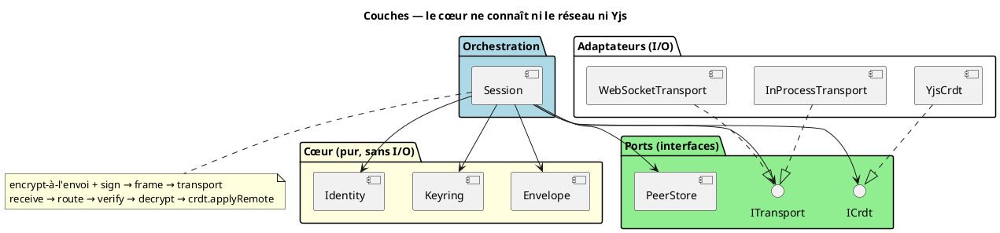
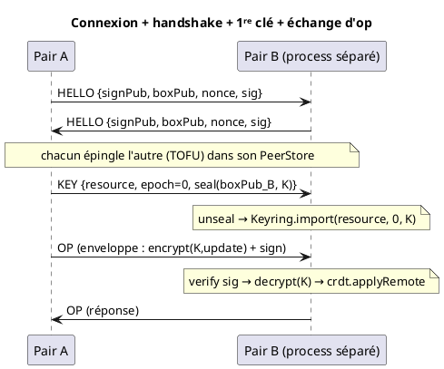
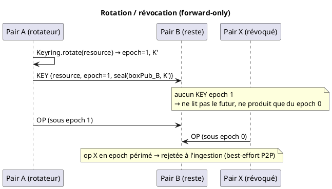

<!-- SPDX-License-Identifier: AGPL-3.0-or-later -->
<!-- SPDX-FileCopyrightText: 2026 Jean Leloup -->

# EdgeSync — protocole de collaboration P2P (design)

Lib réutilisable, **agnostique au transport et au CRDT**, pour de l'édition
collaborative **chiffrée de bout en bout et signée**, strictement **pair-à-pair**.
Chaque participant est un `Peer` qui tourne *cette même lib*. Le modèle de confiance
et de clés vit dans [security-channel-model.md](security-channel-model.md) ; ce
document décrit l'**architecture logicielle** et le **protocole de fil**.

## A. Périmètre

**Dans le protocole (v0)** : identité (2 paires de clés), CRDT chiffré, enveloppe
signée, époques + rotation, handshake entre pairs, livraison de clé wrappée.

**Hors protocole — explicitement** :
- **Le serveur.** Il n'est *jamais* une brique du protocole. S'il existe, c'est un
  **assistant externe** : soit un *peer headless always-on* (il tourne la même lib,
  sans privilège), soit un *provider de clés/identité*. Aucun code de ce protocole ne
  suppose sa présence.
- ACL op-log (capacités seules en v0), partage par lien, OPRF, persistance des clés
  au repos (éphémères en mémoire pour le POC), découverte / NAT traversal.

> Conséquence d'architecture : **aucune dépendance, aucun `if (server)`** dans le
> cœur. Le serveur n'est qu'un `Peer` ou un `KeyProvider` injecté de l'extérieur,
> plus tard.

## B. Architecture (hexagonale, dépendances vers le centre)



- **Identity** *(pur)* — les 2 paires d'un pair (Ed25519 signe, X25519 wrap) +
  l'identité publique des pairs.
- **Envelope** *(pur)* — sérialise/parse l'enveloppe de fil ; `encrypt`/`decrypt`
  (XChaCha20-Poly1305) ; `sign`/`verify` (Ed25519) ; `seal`/`unseal` (hybride
  X25519). Fonctions pures sur des octets.
- **Keyring** *(pur)* — clés de contenu par ressource : époques, historique
  `{époque → clé}`, époque courante ; `rotate`, `import` (depuis un wrap reçu).
- **ICrdt** *(port)* — le protocole ne connaît pas Yjs ; il parle à une interface.
- **ITransport** *(port)* — le protocole ne connaît pas le réseau ; deux adaptateurs
  (in-process pour les tests, WebSocket pour deux process séparés).
- **PeerStore** *(magasin §1.5.1)* — clés publiques connues, épinglées en TOFU au
  handshake.
- **IStorage** *(port)* — persistance (identité, keyring, peerstore, contenu en
  ciphertext). Le protocole ne gère pas le chiffrement au repos : c'est l'app
  ([ADR-0011](adr/0011-persistance-port-istorage.md)). Adaptateurs : in-memory,
  filesystem.
- **Session** — l'unique orchestrateur. Câble tout, applique encrypt-à-l'envoi,
  route les messages entrants, gère rotation/grant, et `persist()` via `IStorage`.

## C. Interfaces (contrats)

```ts
// ---- Cœur : pur, aucune I/O ----
interface PeerIdentity { signPub: Uint8Array; boxPub: Uint8Array }   // public
interface OwnIdentity extends PeerIdentity {
  sign(msg: Uint8Array): Uint8Array
  unseal(sealed: Uint8Array): Uint8Array          // X25519 → moi
}

// Envelope (fonctions pures)
type Envelope = { epoch: number; nonce: Uint8Array; ciphertext: Uint8Array;
                  sig: Uint8Array; signerPub: Uint8Array }
encodeEnvelope(e: Envelope): Uint8Array
decodeEnvelope(b: Uint8Array): Envelope
encrypt(key: Uint8Array, plaintext: Uint8Array): { nonce; ciphertext }   // XChaCha
decrypt(key: Uint8Array, nonce: Uint8Array, ciphertext: Uint8Array): Uint8Array
seal(recipientBoxPub: Uint8Array, plaintext: Uint8Array): Uint8Array      // hybride
unseal(boxPriv: Uint8Array, sealed: Uint8Array): Uint8Array

interface Keyring {
  currentEpoch(resource: string): number
  key(resource: string, epoch: number): Uint8Array | undefined  // historique
  rotate(resource: string): { epoch: number; key: Uint8Array }  // nouvelle époque
  import(resource: string, epoch: number, key: Uint8Array): void // depuis un KEY reçu
}

// ---- Ports ----
interface ICrdt {
  onLocalUpdate(cb: (update: Uint8Array) => void): () => void
  applyRemote(update: Uint8Array): void
  snapshot(): Uint8Array
  stateVector(): Uint8Array                       // pour le catch-up
  diffSince(sv: Uint8Array): Uint8Array
}
interface ITransport {
  onMessage(cb: (from: string, bytes: Uint8Array) => void): () => void
  onPeerUp(cb: (from: string) => void): () => void
  send(to: string, bytes: Uint8Array): void
}

// ---- Orchestrateur ----
class Session {
  constructor(id: OwnIdentity, crdt: ICrdt, keyring: Keyring,
              transport: ITransport, peers: PeerStore, resource: string)
  rotate(): void          // nouvelle époque + seal aux pairs connus + envoi KEY
  grant(peer: PeerIdentity): void   // seal la clé courante à un nouveau pair
}
```

## D. Modèle crypto (rappel + 1 décision)

- Chaque op : **chiffrée** (XChaCha20-Poly1305, époque courante) **+ signée**
  (Ed25519). Enveloppe `[epoch:4][nonce:24][ciphertext][sig:64][signerPub:32]`, la
  signature couvre `epoch‖nonce‖ciphertext`.
- **Chiffrement ⊥ signature** : l'AEAD authentifie le groupe, la signature
  l'individu (§1.1).
- **Époques** : tag en clair, auto-validé par l'AEAD. **Encrypt-à-l'envoi** :
  l'historique de clés sert à *lire* le passé, la frontière de poussée est toujours
  sous l'époque courante.
- **Révocation forward-only** : rotation = révoque la lecture ; détenir la clé
  courante = droit d'écrire (write-revocation, best-effort en P2P).

> **DÉCISION OUVERTE — Q1, modèle de clés.**
> *Proposé* : enveloppe `K_vault → K_doc` par ressource dès v0 (passe-partout +
> partage fin). *Alternative* : une clé de contenu unique epoch'd (plus simple,
> reporte la hiérarchie). → à trancher avec toi.

## E. Protocole de fil (messages)

> Référence détaillée champ par champ (déclencheurs, validation, séquences) :
> [edgesync-wire-protocol.md](edgesync-wire-protocol.md). Vue d'ensemble ci-dessous.

Message encadré = `[type:1][payload]`.

| Type | Payload | Rôle |
|---|---|---|
| `HELLO` | `{ signPub, boxPub, nonce, sig(nonce) }` | handshake : prouve l'identité, épingle en TOFU (PeerStore) |
| `OP` | une **enveloppe** (cf. §D) | un update CRDT chiffré + signé |
| `KEY` | `{ resource, epoch, sealed }` | livraison de clé wrappée (grant + rotation) |
| `SYNC_REQ` | `{ stateVector }` | *(si Q4 = complet)* demande de catch-up |
| `SYNC_RESP` | `{ ops[] \| snapshot }` | *(si Q4 = complet)* réponse de catch-up |

> **DÉCISION OUVERTE — Q4, périmètre des messages.**
> *Proposé* : commencer **minimal** (`HELLO` + `OP` + `KEY`). *Alternative* :
> inclure `SYNC_*` dès v0 — en P2P pur, la reconnexion d'un pair en retard est
> fréquente, donc le catch-up a plus de valeur ici qu'en mode serveur. → à trancher.

## F. Modèle de connexion P2P (POC)

Pur P2P, **sans signaling** : un `Peer` peut à la fois **écouter** et **composer**.
Le test lance le pair B dans un **process séparé** qui écoute ; le pair A compose
vers B. Les deux tournent un code identique ; « écouter » n'est qu'un rôle, pas un
serveur. En production, on remplace l'adaptateur `ITransport` (WebRTC / libp2p /
réseau local) — *le protocole ne change pas*.

## G. Séquences





## H. Plan de test (headless, vitest, pur P2P)

| # | Assertion | Transport |
|---|---|---|
| a | les octets sur le transport sont du **chiffré** (aucune fuite du clair) | in-process |
| b | deux pairs **convergent** sur le message | in-process |
| c | **rotation** : un pair revenu re-key à l'envoi et **merge** | in-process |
| d | un pair **révoqué** (sans clé epoch+1) ne lit pas le futur ; sa poussée epoch périmé est **rejetée** | in-process |
| e | deux pairs syncent **E2E sur un vrai WebSocket entre deux process séparés** | WebSocket |

Chaque module pur (Envelope, Keyring) a en plus ses tests unitaires isolés.

## I. Décisions

**Actées** (cf. security-channel-model.md) : collab = protocole P2P ; serveur
hors-scope ; identité = 2 paires ; enveloppe figée ; encrypt-à-l'envoi ;
forward-only. **Proposées, faible enjeu** (vétables) : CRDT derrière `ICrdt`
(Yjs adaptateur) ; transport derrière `ITransport` (in-process + WebSocket) ;
PeerStore TOFU. **Ouvertes** : Q1 (modèle de clés), Q4 (périmètre des messages).

## J. ADR à produire (après validation du design)

ADR-0001 collab = protocole P2P · ADR-0002 serveur hors protocole · ADR-0003
identité à 2 paires · ADR-0004 format d'enveloppe · ADR-0005 encrypt-à-l'envoi &
révocation forward-only · ADR-0006 ports ICrdt/ITransport.
