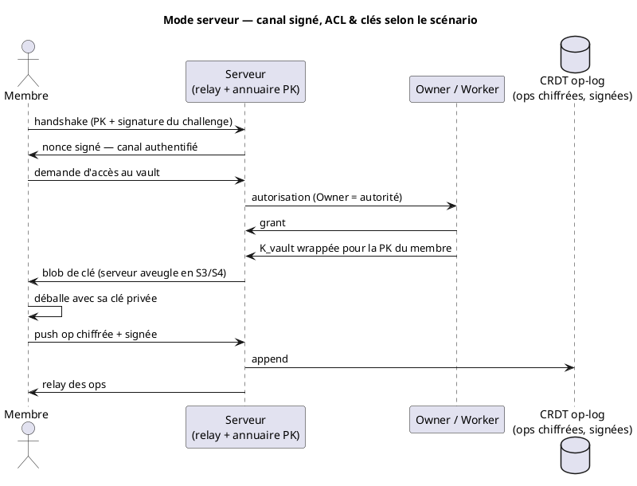
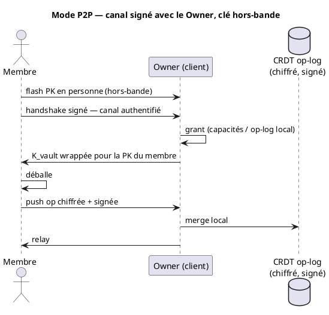
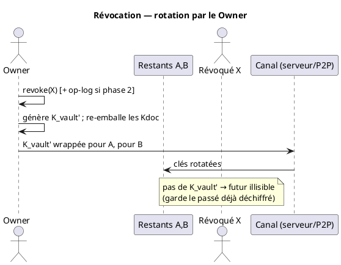
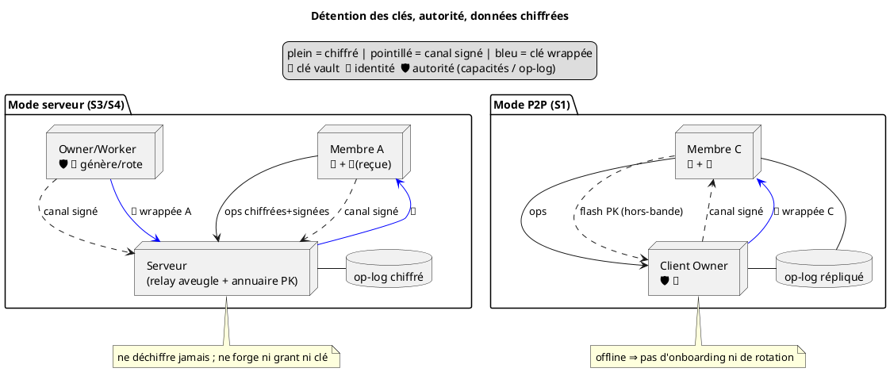

<!-- SPDX-License-Identifier: AGPL-3.0-or-later -->
<!-- SPDX-FileCopyrightText: 2026 Jean Leloup -->

# 1 Modèle de sécurité — canal signé, ops chiffrées, ACL signée

Réflexion d'architecture (pré-Pilier 4). Modèle de confiance, modèle de clés, et
mécanique de partage/révocation, déclinés par scénario.

## 1.1 Décisions actées

- [x] **Signer le canal ET signer chaque op — deux couches distinctes.** Le canal
  authentifie la *session* (transport, éphémère, point-à-point). La signature
  d'auteur dans l'op authentifie la *donnée* (provenance durable, E2E ; survit au
  relais, au rejeu, à la compaction). On garde **les deux** : le canal-seul
  laisserait le relais forger des écritures et tuerait audit / read-only /
  révocation-d'écriture. On *produit* toujours la signature d'op ; on peut
  *différer sa vérification* à la phase write-authz. Voir §1.7.1.
- [x] **Chiffrement ⊥ signature.** Le chiffrement dit *qui peut lire* ; la signature
  dit *qui a écrit*. Le tag AEAD authentifie le **groupe** (quiconque a la clé),
  jamais l'**individu** — il ne remplace donc pas la signature pour l'autorisation
  (un révoqué qui a gardé la clé produit un chiffré valide). Comme les *sender keys*
  de Signal : clé de groupe pour la confidentialité + signature individuelle pour
  l'auteur.
- [x] **Ops chiffrées dans le CRDT, dans les 4 scénarios (P2P inclus).** Le relais
  (serveur ou pair) ne voit que du chiffré → il ne peut ni indexer, ni prévisualiser,
  ni compacter l'état Yjs (la compaction redevient client). En P2P aussi : sans ça,
  les ops circuleraient en clair pour tout pair-relais. ⚠️ **Aujourd'hui rien n'est
  encore chiffré** : le relais est *opaque* au sens « ne parse pas », pas « ne peut
  pas lire ». C'est du travail à faire, purement additif.
- [x] **Clés en enveloppe** : `K_vault` symétrique ; `K_doc` par note, *aléatoire et
  indépendante*, emballée par `K_vault`. **Pas de dérivation** (`HKDF(K_vault, docId)`),
  qui tuerait la rotation indépendante et la révocation propre par note. `K_vault`
  est un **passe-partout** : les `K_doc` emballées voyagent *avec* les données →
  partager le vault entier = **un seul** `wrap(PK, K_vault)`, pas N clés. Voir §1.4.
- [x] **Époques de clés** : chaque op chiffrée porte un **id d'époque en clair** ; un
  membre conserve un **historique `{époque → clé}`**, pas seulement la clé courante.
  Le tag est un *indice de déchiffrement auto-validé par l'AEAD* (mauvais tag →
  échec, pas besoin de confiance). **Règle : adopter la dernière époque avant
  d'émettre** (sinon écriture neuve lisible par un révoqué) — imposable même par un
  serveur **aveugle**, le tag étant en clair. Voir §1.6.1.
- [x] **Magasin de clés des pairs** : la clé publique d'un pair est un **état local
  épinglable** (≠ lookup serveur refait à chaque fois), source de l'identité ET
  canal asynchrone de contrôle. Voir §1.5.1.
- [x] **Admission = pouvoir réservé au Owner.** Phase 1 : par **séparation de
  capacités** (le Owner seul détient `K_vault`). Phase 2 si besoin : **op-log ACL
  signé** (audit, read-only, multi-admin). Voir §1.7.
- [x] **Deux rôles d'owner, jamais fusionnés dans les structures de données** :
  *owner-réseau* (ordre / relais / HA — hébergeable par le serveur) vs
  *owner-du-vault* (admission / clés — jamais le serveur en S3/S4, sinon E2E rompu).
  Co-localisés aujourd'hui, champs séparés pour permettre la divergence. **Le serveur
  est additif** : protocole de base identique partout, il n'ajoute que des rôles que
  sa présence always-on rend possibles ; le front ne change pas. Voir §1.7.4.
- [x] **Collab = protocole P2P réutilisable.** Une seule lib de collaboration
  (identité + CRDT chiffré + transport) ; le **serveur est un peer headless
  always-on** qui tourne la *même* lib (pas de code serveur spécial) — relais/ordre
  aveugle en S3/S4, détenteur de clés en S2. Effondre le fork client/serveur. Modèle
  de référence : **any-sync (MIT)**. Voir §1.7.4.
- [x] **Révocation forward-only** : le membre révoqué garde le passé qu'il a pu
  déchiffrer ; la rotation ne protège que le futur. **Lecture ≠ écriture** : la
  rotation révoque la lecture ; **révoquer l'écriture = chiffrement-à-l'envoi +
  rejet des poussées à époque périmée** (détenir la clé courante = droit d'écrire).
  Voir §1.7.1.
- [x] **Autorisation à l'ordre fait autorité** : jamais sur un `issuedAt`
  auto-déclaré (forgeable → backdating), toujours sur la position dans un ordre.
  **Assignation centralisée** (séquence par serveur/owner) **+ vérification
  décentralisée** (chaîne de hash + gossip) : centraliser l'*ordre* ≠ centraliser la
  *confiance*. Voir §1.7.1.
- [x] **Refus actif = exclusivité serveur** : pas d'équivalent temps-réel en P2P
  (pas de tiers always-on). *Tier-1* = gating de livraison (ACL sur relais aveugle) ;
  *tier-2* = participation oblivious au déchiffrement (OPRF / proxy re-encryption),
  jamais de split XOR. Voir §1.7.2.
- [x] **L'identité ne peut pas avoir le serveur pour *seule* racine de confiance**
  *si* on veut l'E2E (S3/S4) — contrainte vide en S2, qui n'achète pas l'E2E. Même
  donnée (magasin §1.5.1), seule la *politique* change selon le scénario. Voir §1.5.
- [x] **Compaction réécrivante (réencryption budgétée)** : roter ne re-chiffre pas le
  passé ; un job de fond *throttlé* réécrit l'historique sous la clé courante,
  **partiellement** possible (granularité par op → réglage fin des perfs), piloté par
  une **politique de rétention**. Tue progressivement une clé volée contre le store
  vivant — mais **ne défait pas** un vol déjà consommé. Voir §1.6.2.
- [ ] ==**Owner offline (P2P)** : pas d'admission ni de rotation tant qu'il est hors-ligne.
  Pas de délégués pour l'instant (le serveur peut faire tourner l'*owner-réseau* en
  HA, jamais l'*owner-du-vault* en S3/S4).==

---

## 1.2 Deux axes, quatre scénarios

Un seul moteur crypto, réglé par deux axes (+ toggle présence serveur) :

- [ ] **Axe A — qui détient les clés de contenu ?** Serveur (custodial) / utilisateur.
- [ ] **Axe B (si utilisateur) — où est ancrée l'identité d'un pair ?** Serveur ==(TOFU)==
  / hors-bande (physique, empreinte, transparence).

| #      | Scénario                          | Clés             | Identité        | Serveur |
| ------ | --------------------------------- | ---------------- | --------------- | ------- |
| **S1** | P2P pur                           | utilisateur      | hors-bande      | absent  |
| **S2** | Serveur custodial                 | serveur (worker) | comptes serveur | présent |
| **S3** | Serveur aveugle, identité asserée | utilisateur      | serveur (TOFU)  | présent |
| **S4** | Serveur de découvrabilité         | utilisateur      | hors-bande      | présent |

**S1 et S4 ont la même crypto et la même sécurité** ; ils ne diffèrent que par la
présence d'un serveur pour HA/backup/découverte. C'est l'argument entreprise :
*si le serveur tombe, on continue en P2P* — à condition que les identités aient
été ancrées **avant** la panne. Référence : **WhatsApp = S3 durci** (TOFU + QR
hors-bande + log de transparence ; sender keys rotées par groupe).

---

## 1.3 Matrice par scénario

> "idem S3" = mécanique strictement identique, seule la confiance change.

| Opération | S1 — P2P | S2 — Custodial | S3 — Aveugle / TOFU | S4 — Aveugle / hors-bande |
|---|---|---|---|---|
| **Détention des clés** | utilisateur | serveur (worker) | utilisateur | utilisateur |
| **Identité / découverte** | flash PK en personne ; pas d'inconnus | comptes serveur | annuaire PK serveur, **TOFU** (épingle + alerte) | annuaire serveur **+ vérif hors-bande** (QR/empreinte/transparence) |
| **Partage du vault** | `wrap(PK, K_vault)` envoyé en P2P direct | le worker emballe (serveur voit la clé) | `wrap(PK, K_vault)`, blob stocké par serveur **aveugle** | idem S3, PK **vérifiée** avant le wrap |
| **Partage d'une note** | `wrap(PK, K_doc)` direct | worker gère | `wrap(PK, K_doc)` via serveur aveugle | idem S3 |
| **Partage par lien** | **impossible** (pas de rendez-vous always-on) | trivial (serveur voit tout) | **fragment d'URL** `…#Klink` ; révocation tier-1 (gate livraison) ou tier-2 (OPRF) | idem S3 |
| **Qui peut admettre** | Owner only, **doit être en ligne** | worker (always-on) | Owner online pour *minter* un accès ; serveur sert les blobs **existants** en HA | idem S3 |
| **Révocation** | Owner rote `K_vault`, re-wrap restants, **forward-only** | worker rote, immédiate | idem S1, blobs re-servis par serveur | idem S3 |
| **Rotation de clé** | redistribution P2P directe | gérée serveur | Owner re-wrap → blobs servis par serveur | idem S3 |
| **Récupération (clé perdue)** | seed / récupération sociale (Shamir) | **facile** : compte serveur (le serveur détient les clés) | seed / social — **le serveur ne peut PAS aider** (aveugle) | idem S3 |
| **Disponibilité** | Owner offline ⇒ stop ; lecture entre pairs présents | maximale | HA des accès existants ; admission = Owner online | idem S3 **+ survit en P2P si le serveur tombe** |
| **Défend contre un serveur…** | tout (pas de serveur) | **rien** (serveur de confiance) | **passif** uniquement (MITM identité possible) | **actif** |

**Caractère de chaque scénario, en une ligne :**

- **S1** — sécurité maximale, disponibilité minimale, cercle fermé. Le mode "rien
  à cacher à personne, même pas à un serveur".
- **S2** — confort maximal, confidentialité nulle vis-à-vis du serveur. Le mode
  "SaaS classique" ; honnête tant qu'on l'écrit à l'utilisateur.
- **S3** — E2E *contre un serveur curieux*. Ce que 90 % des gens veulent dire par
  "chiffré". Faux sentiment de sécurité si l'adversaire est actif.
- **S4** — E2E réel (niveau P2P) + HA. Le mode entreprise/souveraineté : le
  serveur n'est qu'une commodité, jamais une racine de confiance.

---

## 1.4 Modèle de clés (enveloppe)

```plantuml
@startuml key-hierarchy
title Hiérarchie de clés — K_vault emballe les K_doc (wrapping, pas dérivation)

object "🔑 K_vault" as KM
object "wrap(K_vault, Kdoc1)" as W1
object "wrap(K_vault, Kdoc2)" as W2
object "Kdoc1 (note 1, aléatoire)" as K1
object "Kdoc2 (note 2, aléatoire)" as K2
database "ops note 1 (chiffrées Kdoc1)" as O1
database "ops note 2 (chiffrées Kdoc2)" as O2

KM --> W1 : déballe
KM --> W2 : déballe
W1 ..> K1
W2 ..> K2
K1 --> O1 : déchiffre
K2 --> O2 : déchiffre
note right of KM : membre du vault → lit tout
note bottom of K1 : partage d'une note → Kdoc1 seul, jamais K_vault
@enduml
```

Distribution : `wrap(PK_pair, clé)` où `clé` = `K_vault` (tout) ou `K_doc` (une
note). La crypto de contenu est **identique dans les 4 scénarios** ; seuls
changent la transmission du blob et l'ancrage de l'identité.

**L'emballage n'est pas exclusif.** Une même `K_doc` peut être emballée
*plusieurs fois*, vers des cibles différentes — c'est ce qui permet de partager
une note **sans** donner le vault :

```
ciphertext(note) = Enc(K_doc, contenu)        # contenu chiffré une seule fois
wrap_vault       = Enc(K_vault, K_doc)         # les MEMBRES (qui ont K_vault) lisent
wrap_bob         = Enc(PK_bob, K_doc)          # Bob (non-membre) lit CETTE note
```

Bob déballe `wrap_bob` avec sa clé privée → obtient `K_doc` → lit. Il ne voit
jamais `K_vault`, ni le répertoire du vault (domaine `K_vault`) — donc même pas
l'existence des autres notes. Le partage de note = *fabriquer un emballage de
plus*, pas re-chiffrer le contenu.

**`K_vault` = passe-partout, pas un trousseau.** On ne distribue jamais les `K_doc`
une par une. Chaque note range, *à côté d'elle dans le vault*, sa propre clé
emballée sous `K_vault` (`Enc(K_vault, K_doc)`). Image : `K_vault` est la clé
maîtresse d'un immeuble ; chaque note est un coffre, et la clé du coffre dort dans
une enveloppe fermée par la maîtresse, posée sur le coffre. Donner le vault entier à
Bob = **une seule** opération `wrap(PK_bob, K_vault)` ; Bob déballe `K_vault` une
fois, puis à la lecture ouvre l'enveloppe de chaque note pour en tirer sa `K_doc`.
Les clés par note sont *reconstituées à la volée*, jamais transmises en lot — sinon
partager un vault de 500 notes voudrait dire transmettre 500 clés.

**Authentification de groupe vs d'individu.** Déchiffrer prouve seulement « cette op
vient de quelqu'un qui a la clé » (le *groupe*). Savoir *quel* membre l'a écrite
exige la **signature d'auteur** (l'*individu*). C'est pourquoi chiffrement et
signature coexistent et ne se remplacent pas (§1.1).

---

## 1.5 Le problème central : authenticité de l'identité

Tout partage se réduit à : **la PK qu'on me donne pour « Bob » est-elle la sienne ?**

- **Serveur passif** → l'annuaire suffit (S3).
- **Serveur actif** → il renvoie `PK_attaquant` pour « Bob » ; on wrappe pour
  l'attaquant. Il ne voit jamais la clé — il nous l'a fait chiffrer *à lui*.
  Il faut un **ancrage hors-bande** (S4) : (1) clé connue par un autre canal,
  (2) TOFU, (3) preuves auto-certifiantes (Keybase), (4) log de transparence
  (détection, à condition de l'*imposer* côté client).

Règle : **le serveur peut courtier l'échange de clés, jamais être la racine de
confiance de l'identité.**

### 1.5.1 Magasin de clés des pairs (invariant de socle)

La PK d'un pair doit être un **état local, persistant, épinglable**, pas une
valeur re-cherchée auprès du serveur à chaque usage :

```
pair "Bob" → { pubkey: PK_bob, statut: non-vérifié | épinglé | vérifié-hors-bande, pinnedAt }
```

- Tout usage d'identité (emballer une clé pour Bob, vérifier ses signatures
  d'ops) lit **ce magasin**, jamais un appel serveur direct.
- Le serveur ne sert qu'à *peupler* le magasin au premier contact et à *proposer*
  un changement — qui déclenche une **alerte**, jamais un écrasement silencieux.
- **Pourquoi c'est du socle** : si le code fait `serveur.getPeerKey()` partout, la
  racine de confiance de l'identité est le serveur → cloué à S3. Si l'identité est
  un état local marquable, S3 (auto-accepter) et S4 (exiger vérifié + alerter) ne
  sont qu'une *politique* sur la même donnée. La forme de la donnée n'est pas
  différable ; la politique l'est.
- **Bonus** : un pair épinglé = un **canal asynchrone authentifié**. On peut lui
  emballer n'importe quoi (`wrap(PK_pair, …)`) à tout moment, sans qu'il soit en
  ligne, sans handshake live — c'est ce qui rend la livraison de clés rotées et
  les re-grants triviaux en asynchrone (voir §5.6). Pas besoin de Double Ratchet
  pour ces messages de contrôle occasionnels.

---

## 1.6 Mécaniques (le *comment*, référencé par la matrice)

- **Partage vault** : `wrap(PK, K_vault)`. Le destinataire lit tout, y compris le
  futur. Possession de `K_vault` = capacité de lecture **et** de re-partage.
- **Partage note** : `wrap(PK, K_doc)`. Possible grâce au wrapping.
- **Partage par lien** : secret dans le **fragment d'URL** (jamais envoyé au
  serveur) ; `Klink` fraîche par lien.
  - *Tier-1* : le serveur gate la **livraison du blob** (aveugle ; forward-only).
  - *Tier-2* : le serveur participe au déchiffrement via schéma **aveugle**
    (OPRF / proxy re-encryption) → révocation réelle. ⚠️ **jamais de split XOR**
    (réunir les parts révélerait la clé). Coût : serveur obligatoire par
    déchiffrement — acceptable, le lien est déjà serveur-only.
  - ⚠️ Le lien est un **bearer token** : zéro identité, mode le plus faible.
- **Rotation `K_vault`** : `K_vault'`, re-emballer chaque `K_doc` sous `K_vault'`,
  re-distribuer aux restants. **Pas de re-chiffrement du contenu.** O(notes + membres).
- **Révocation forward-only (ce qu'on fait)** : ouvrir une **nouvelle époque** —
  les ops *futures* d'une note sont chiffrées sous `K_doc'`, les anciennes restent
  sous `K_doc`. On **ne re-chiffre pas** l'historique. `K_doc'` est emballée pour
  les restants (`wrap(PK, K_doc')`), pas pour le révoqué. Le log devient
  *multi-époques*. Le révoqué garde l'ancienne clé → lit le passé, pas le futur.
- **Révocation « réelle » (ce qu'on ne fait pas)** : re-chiffrer tout l'historique
  sous une nouvelle clé et jeter l'ancienne — O(taille), *cher*, et casserait le
  merge des membres restants hors-ligne.

### 1.6.1 Merge à travers une rotation

Le CRDT fusionne du **plaintext, après déchiffrement** ; Yjs ignore le chiffrement.
Donc, pour qu'un membre resté hors-ligne (qui a produit des ops sous l'ancienne
époque) se re-synchronise sans heurt :

1. Chaque op porte son **id d'époque** ; le décodeur choisit la bonne clé dans son
   historique `{époque → clé}`. (Sans ce tag, une vieille op arrivant tard
   échouerait au déchiffrement sous la clé courante.)
2. Les membres **conservent les anciennes clés** — sinon plus personne ne lit le
   passé (c'est pourquoi forward-only est *structurel*, pas qu'une politique).
3. Les ops offline (chiffrées sous l'ancienne époque) sont déchiffrées par
   quiconque a cette clé, puis **fusionnées par Yjs** indépendamment de l'ordre
   d'arrivée (commutativité CRDT).
4. La nouvelle clé arrive au membre via `wrap(PK_membre, K_doc')` déposé sur le
   relais aveugle (ou file P2P) — récupérée à la reconnexion, ajoutée à son
   historique d'époques. C'est le canal asynchrone du magasin (§4.1).

**Qui tague l'époque ?** L'auteur, à l'émission, avec l'époque de la clé qu'il a
utilisée — *en clair* dans l'enveloppe. Ce n'est pas une prétention d'autorité mais
un **indice de déchiffrement auto-validé** : un tag faux fait échouer l'AEAD, donc
personne n'a besoin de lui faire confiance. L'**époque courante** est établie par le
rotateur (l'owner-du-vault) et distribuée via les wraps (`wrap(PK, K_doc')`
labellisés). Le **numéro** doit venir d'une source monotone faisant autorité :
compteur simple si un seul rotateur, position dans la chaîne ACL si multi-admin
(sinon deux « époque 5 » de clés différentes → ambiguïté de déchiffrement).

**Règle de sécurité — adopter la dernière époque avant d'émettre.** Écrire sous une
époque périmée juste après une révocation rend l'écriture *neuve* lisible par le
révoqué (il a gardé l'ancienne clé). En mode serveur, le relais **impose** la
fraîcheur en rejetant les ops à époque périmée — possible *même aveugle*, le tag
étant en clair. En P2P pur : best-effort, fenêtre de fuite incompressible entre la
rotation et le moment où l'auteur l'apprend.

### 1.6.2 Compaction = re-chiffrement amorti sous la clé courante

Re-chiffrer l'historique **à chaque rotation** = O(taille) par révocation,
intenable. Mais le faire **périodiquement** (compaction), c'est la même opération
amortie, et c'est bénéfique :

- Un client à accès complet déchiffre le log (via son historique de clés),
  reconstruit l'état Yjs, et écrit un **snapshot chiffré sous la clé courante**.
  Côté client (le relais est aveugle). Coût O(taille), occasionnel.
- **Nouveau membre** : il ne reçoit que la clé courante → il **ne peut pas** lire
  les ops sous d'anciennes époques. On ne lui donne pas tout l'historique de clés ;
  on lui sert le **snapshot sous la clé courante** (l'*état*, pas l'historique).
  C'est la norme : en messagerie un nouveau ne voit pas le passé (feature) ; pour
  un document, on lui donne l'état courant via snapshot.
- Après compaction sous `K_doc'`, on peut **jeter les anciennes clés et ops** → un
  révoqué qui avait gardé l'ancienne clé ne lit plus l'état canonique (il garde
  seulement ce qu'il avait déjà copié). La compaction est donc le chemin
  *progressif* vers une exclusion réelle, sans la payer à chaque révocation.

**Destructrice vs réécrivante.** Deux formes, à ne pas confondre :

- *Destructrice* : ops → snapshot, on **jette** le passé. Tue l'ancienne clé (plus
  rien à lire) mais **perd l'historique de versions** (feature produit).
- *Réécrivante* : on déchiffre le passé (via l'historique de clés), on le
  **re-chiffre sous la clé courante** et on le **garde**. Préserve l'historique ET
  invalide l'ancienne clé. Coût O(taille) compute, stockage conservé.

La réécrivante est *exactement* la « réécriture de l'historique » qui invalide une
clé volée sans rien perdre. Elle peut être **partielle** (chaque op est chiffrée
indépendamment → on choisit quelles ops / quelle fenêtre réécrire) : c'est le levier
pour **régler finement les perfs** et étaler le travail sous budget. Partielle =
protection partielle (une clé volée lit encore ce qui n'a pas été réécrit), donc un
**drain progressif** vers l'exclusion réelle, piloté par une **politique de
rétention** (la destructrice = rétention 0).

**Le travail est client/worker, pas relais** (il faut l'historique de clés ; le
relais est aveugle). En S3/S4 : un membre-client, opportuniste (en ligne et oisif).
En S2 : un worker.

**Tension à trois (on n'a pas les trois en crypto pure)** : (a) tuer une clé volée,
(b) garder l'historique, (c) cacher le passé pré-adhésion aux nouveaux membres.
Réécrire sous `K'` donne (a)+(b), mais quiconque a `K'` lit tout → (c) saute. La
**résolution passe par le serveur** : re-chiffrer sous `K'` (a+b) **+ gater la
livraison** du blob d'historique (snapshot aux nouveaux, historique complet aux
anciens → c via tier-1). En P2P pur, (c) n'est pas enforçable contre un membre qui a
`K'`. Encore l'apport serveur.

> **La réencryption ne défait pas un vol déjà consommé.** Si l'attaquant a déjà lu
> ou copié chiffré + clé, réécrire *ta* copie ne dé-lit rien. Ça ne protège que ce
> qu'il n'a pas encore récupéré, et réduit la fenêtre.

---

## 1.7 Autorisation & enforcement — phase 1 capacités, phase 2 op-log

**Phase 1 (maintenant) — séparation de capacités.** Le Owner seul détient
`K_vault` ; les membres reçoivent des `K_doc`. "Seul le Owner admet au vault" est
obtenu *par construction* (on ne partage pas ce qu'on n'a pas). Pas de log, donc
pas d'audit, pas de read/write enforçable, pas de multi-admin.

**Phase 2 (si besoin) — op-log ACL signé.** Journal append-only d'ops
`{type, subject, resource, permission, issuer, prev(hash), sig}` ; genèse
auto-signée par le créateur (racine de confiance) ; validité d'une op = signée
par un `admin` au point d'ancrage ; rejeu local déterministe. Apporte
**audit + read-only + multi-admin + autorité prouvable** contre un relais.
Limites : autorisation ≠ enforcement (le `revoke` déclenche la rotation, ne
déchiffre rien) ; assis sur la couche identité (§4) ; le relais peut mentir par
omission (gossip requis). **Prérequis déjà acquis** : ops signées dès phase 1.

> N'ajouter l'op-log que si tu as réellement besoin de read-only, d'audit, ou de
> multi-admin. Sinon les capacités suffisent, pour dix fois moins de code.

### 1.7.1 Révocation : lecture ≠ écriture

Deux axes orthogonaux, à ne pas confondre :

- **Révoquer la lecture** = rotation de clé forward-only (§5). Passif, cryptographique.
- **Révoquer l'écriture** : avec le **chiffrement-à-l'envoi** (l'offline ne pousse
  pas du vieux chiffré ; à la reconnexion il reçoit la clé courante et chiffre sa
  delta sous l'**époque courante**), **toute poussée honnête est sous l'époque
  courante**. Donc **détenir la clé courante = droit d'écrire** : le révoqué ne
  l'obtient pas → ses poussées sont *old-epoch* → **rejetées à l'ingestion** par le
  serveur (même aveugle, le tag étant en clair). Course honnête (membre en ligne pas
  encore au courant d'une rotation) → **rejet + bounce** (re-key, renvoi), pas une
  perte. En **P2P pur** : best-effort (pas d'autorité pour rejeter). Variante
  zéro-confiance / audit : vérifier l'auteur **contre l'ACL à la position** (op-log,
  phase 7).

> **Règle d'or : jamais d'autorisation sur un `issuedAt` auto-déclaré** (l'auteur
> le forge → backdating). On autorise sur la **position dans un ordre fait
> autorité** (numéro de séquence assigné par le serveur/owner à la réception, ou
> position dans la chaîne ACL). Le révoqué ne peut pas forger sa position.

Cas dur résiduel (P2P) : une op concurrente forkée "avant la révocation" est
cryptographiquement indistinguable d'un membre honnêtement hors-ligne. Résolu par
politique (**revoke-wins**) + **owner-arbitre** à la réconciliation.

**Blanchiment (résidu du rejet d'époque).** Le rejet des poussées vieux-époque
porte sur le *chiffreur*, pas sur l'*auteur* de l'op CRDT. Donc un pair honnête *en
retard* (pas encore roté) accepte l'op vieux-époque d'un révoqué, puis la re-pousse
sous l'époque courante et **signée de lui** : le contenu du révoqué entre alors sous
une enveloppe valide. Ni le rejet d'époque ni une vérif au niveau enveloppe ne
l'attrapent. **Seule fermeture durable** : signer l'op CRDT par son **auteur** (la
signature voyage avec l'op, même re-chiffrée) et l'autoriser contre l'appartenance →
c'est l'op-log (phase 7). En P2P, résidu best-effort réglé par revoke-wins +
owner-arbitre. *Le rejet d'époque reste la bonne première couche* (cheap, ferme
l'attaque directe et le contournement `SYNC_RESP`).

**Qui produit l'ordre ? Assignation centralisée, vérification décentralisée.** Le
serveur (ou l'owner-client en P2P) **assigne** une séquence à la réception — l'auteur
ne choisit pas sa position, donc backdating impossible. Mais l'ordre est **publié de
façon vérifiable** (séquence signée / chaîne de hash + gossip) : les membres
*reçoivent et contrôlent* l'ordre, le serveur ne peut pas réordonner ni omettre en
silence. Centraliser l'*assignation* (la fonction la moins sensible : numéroter)
n'est pas centraliser la *confiance* — le serveur ordonne, il ne forge pas (ops
signées) ni ne lit (chiffré). L'alternative sans autorité (DAG + résolution
déterministe à la Matrix) n'élimine pas le besoin d'arbitrer le fork malveillant
(revoke-wins par l'owner) ; elle retire seulement l'exigence *online*, au prix d'une
grosse complexité. any-sync tranche pareil (consensus-node qui linéarise).

### 1.7.2 La limite P2P : pas de refus actif

Le **refus actif temps-réel** (serveur qui ne sert plus le blob, OPRF tier-2)
exige un tiers **toujours en ligne**. En P2P pur, personne pour refuser → la
double sécu s'effondre à une seule couche (*ne-peut-pas-déchiffrer*). Ce n'est pas
un défaut, c'est la définition du P2P, et c'est ce qui rend le mode serveur
*plus fort sur l'enforcement*, pas seulement plus pratique.

| | Confidentialité (lecture) | Enforcement écriture | Refus actif temps-réel |
|---|---|---|---|
| **P2P** | forward-only (passif) | owner-arbitre *quand online* | **impossible** |
| **Serveur** | forward-only (passif) | serveur/owner à l'ordre canonique | **oui** (refus de relais / OPRF) |

**Comment le serveur refuse, concrètement :**

- *Tier-1 — gating de livraison (défaut, serveur aveugle).* Le serveur ne lit rien
  mais **contrôle la distribution** : après révocation, il cesse de servir au révoqué
  les nouveaux blobs (surtout les wraps de clés). Ce n'est pas de l'exclusion crypto
  (le révoqué garde ce qu'il a déjà), c'est du **contrôle de disponibilité** — un
  simple check ACL sur l'endpoint de relais. C'est le mécanisme principal.
- *Tier-2 — participation oblivious (lien, fort).* Le déchiffrement exige une
  interaction live où le serveur contribue un facteur secret **sans voir clé ni
  clair** : **OPRF** (`K = OPRF(secret_serveur, entrée_aveuglée)` ; refuser = ne plus
  répondre → le client ne dérive plus `K`) ou **proxy re-encryption** (le serveur
  transforme chiffré-pour-A en chiffré-pour-B sans déchiffrer ; révoquer B = supprimer
  sa clé de ré-encryption). Coût : serveur online à *chaque* déchiffrement → réservé
  au lien. ⚠️ **Jamais le split XOR** (`K = K1 ⊕ K2`) : chaque déchiffrement légitime
  matérialise `K` complet → cachable → révocation défaite.

### 1.7.3 État de l'art (validation du modèle)

- **any-sync (Anytype)** : design quasi identique — ACL = records signés validés
  comme **liste chaînée sans conflit par un *consensus node*** (= l'autorité qui
  linéarise, ton owner/worker) ; DAG chiffrés, relais aveugle ; changes signés ;
  read key rotée à la révocation. Confirme : la réponse au backdating est de
  **linéariser l'ACL via une autorité**, pas de tolérer la concurrence.
  **Licence MIT** (protocole + nœuds serveur) → réutilisable, compatible AGPL ; on
  peut s'en inspirer, voire porter du code. Les apps client (`anytype-heart`,
  `anytype-ts`) sont sous licence custom — écartées, et inutiles ici.
- **MLS (RFC 9420)** : standard du chiffrement de groupe — **epochs** explicites +
  **TreeKEM** (rekey O(log n) au lieu de O(n)). Référence si les groupes grossissent.
- **Matrix (state resolution v2)** : l'alternative — ACL concurrente + résolution
  déterministe, sans autorité. Le chemin complexe qu'on évite en gardant un owner.

### 1.7.4 Deux rôles d'owner : réseau vs vault (le serveur est additif)

« Owner » recouvre **deux rôles** aujourd'hui fondus, à séparer dans les structures
de données :

| | Owner-réseau | Owner-du-vault |
|---|---|---|
| Rôle | ordonne les ops, gate la livraison, HA | grant/revoke, détient `K_vault`, rote |
| Portée | infra (un par relais) | par ressource (un par vault) |
| Lit ? | non (aveugle en S3/S4) | oui |
| Hébergeable serveur ? | **oui** | **non en S3/S4** (sinon E2E rompu) |

En S2 ils coïncident (serveur custodial = les deux). En S3/S4 ils **doivent** se
séparer. La fusion actuelle n'est donc qu'une simplification S1/S2.

**Conséquence — le serveur est purement additif.** Le protocole de base est
identique dans tous les scénarios ; le serveur n'ajoute que des rôles que sa
présence always-on permet. Exemple : passer X en *reader* → le serveur **met en
file** la demande, l'owner-du-vault **mint le wrap** quand il repasse en ligne, le
serveur **livre**. Le serveur transforme « l'owner doit être en ligne MAINTENANT »
en « l'owner satisfait de façon asynchrone » — *c'est* la valeur HA. **Le front ne
change pas** : il demande un accès et reçoit un wrap, sans savoir si un owner-client
ou un serveur a orchestré.

Pour que ça tienne au niveau code : les checks d'autorisation référencent
l'**identité owner-du-vault** (pas « le serveur l'a dit »), les checks d'ordre
référencent l'**autorité réseau**, et `owner-du-vault` est une **valeur dans l'état
du vault** (genèse de l'ACL / détenteur de `K_vault`) — transférable, possiblement
distincte du relais. Séparer les *noms* maintenant, co-localiser les *valeurs*,
autoriser la divergence plus tard : S2↔S3↔S4 devient une *config*, pas une migration.

---

## 1.8 Séquences

### 1.8.1 Mode serveur (S2/S3/S4)



### 1.8.2 Mode P2P (S1)



### 1.8.3 Révocation (forward-only)



### 1.8.4 Vue structurelle



---

## 1.9 Questions ouvertes

- **Multi-admin** : règles de résolution des ops ACL concurrentes (revoke-wins ?
  ordre déterministe ? quorum ?). Différé avec la phase 2.
- **Transparence imposée** : pour passer S3 → S4 contre serveur actif, le client
  doit *imposer* vérification d'inclusion + gossip. Sinon le log est décoratif.
- **Pour qui le « réellement chiffré » est-il vrai ?** S1/S4 = cercle vérifié
  hors-bande ; S3 = serveur passif. Décision produit, pas technique.
- **Hook de compaction réécrivante** : préparer le point d'entrée `recompact(resource)`
  (vide) + un marqueur « réencryption due » posé à la rotation, drainé par un job de
  fond budgété. Additif (le tag d'époque existe déjà). À scaffolder quand on attaque
  le chiffrement.

## 1.10 Lectures & références

- David Wong, *Real-World Cryptography* (~400 p.) — enveloppe, E2E, Signal &
  sender keys, key transparency, OPRF. Couvre exactement les mécanismes de ce doc.
- **any-sync** (Anytype) — design de référence quasi identique, **licence MIT**
  (protocole + nœuds serveur ; apps client sous licence custom) :
  <https://github.com/anyproto/any-sync>, <https://tech.anytype.io/any-sync/overview>.
- **MLS — RFC 9420** — epochs + TreeKEM (rekey O(log n)) ; référence pour les
  groupes qui grossissent.
- **Matrix state resolution v2** — l'alternative ACL-concurrente sans autorité.
